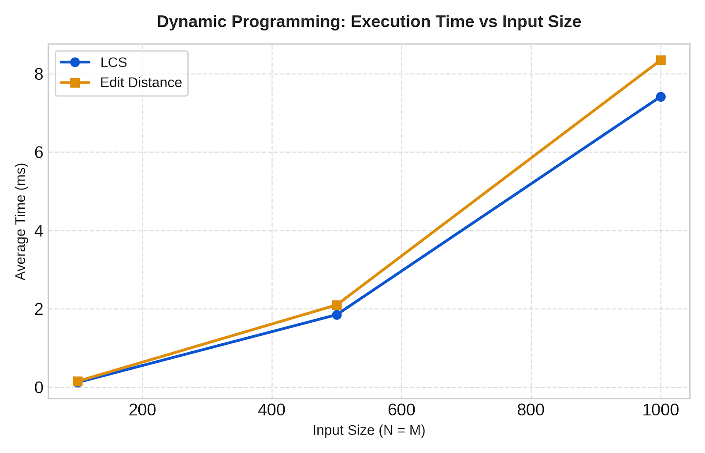
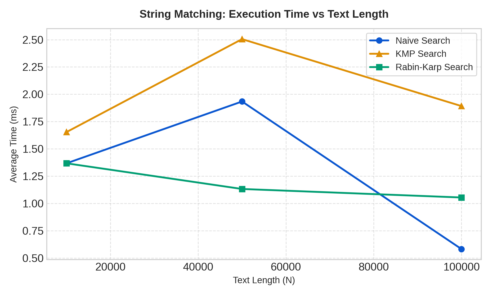

# Text Analysis: Dynamic Programming and String Algorithms

**Author:** Toktar Arkat  
**Course:** Design and Analysis of Algorithms  
**Environment:** Java 21, IntelliJ IDEA, Windows x64  
**Repository Structure:** Standard Single-Module Java Project (`src/` directory containing `dp`, `matching`, `advanced`, and `benchmark` packages).

---

## 1. Problem Description and Algorithm Overview

This repository provides a comprehensive implementation, theoretical analysis, and experimental evaluation of core dynamic programming (DP) algorithms, pattern-matching algorithms, and advanced string suffix structures.

### Implemented Algorithms:
1. **Dynamic Programming (DP):**
    - **Longest Common Subsequence (LCS):** Dynamically computes the length of the longest subsequence shared by two sequences without requiring elements to be contiguous.
    - **Edit Distance (Levenshtein Distance):** Calculates the minimum number of single-character operations (insertions, deletions, substitutions) required to transform string $S_1$ into $S_2$.
2. **String Matching Algorithms:**
    - **Naive String Matching:** A brute-force baseline iterating through all valid alignment offsets to check pattern occurrences.
    - **Knuth-Morris-Pratt (KMP):** Preprocesses the pattern to construct a Longest Prefix Suffix (LPS) table, enabling $O(N + M)$ search by avoiding redundant character re-comparisons upon mismatches.
    - **Rabin-Karp String Matching:** Utilizes a rolling hash function ($d=256$, prime $Q=101$) to achieve fast search times, validating actual character matches only when hash values match.
3. **Advanced String Processing:**
    - **Kasai's Algorithm:** Computes the Longest Common Prefix (LCP) array in linear $O(N)$ time using a input string and its corresponding Suffix Array.

---

## 2. Implementation Decisions and Assumptions

- **Alphabet:** Uniform uppercase English alphabet (`A-Z`, size $|\Sigma| = 26$).
- **Random Seed:** Benchmark input generation uses a fixed random seed (`42`) via `java.util.Random` to guarantee exact experiment reproducibility across execution runs.
- **Empty & Edge Pattern Handling:**
    - If the search pattern is empty (`""`) or its length exceeds the text length ($M > N$), pattern-matching algorithms return an empty result list `[]`.
    - Empty string inputs for LCS return `0`.
    - Empty string inputs for Edit Distance return the length of the non-empty target string.
- **Timing Isolation:** Input string generation, suffix array construction, file operations, and console output are strictly excluded from timing regions. Timing measures core algorithm execution using `System.nanoTime()`.

---

## 3. Complexity Analysis Table

| Algorithm | Main Operation / Recurrence | Best-Case Time | Worst-Case Time | Auxiliary Space | Justification / Explanation |
| :--- | :--- | :--- | :--- | :--- | :--- |
| **LCS** | $DP[i][j] = DP[i-1][j-1]+1$ if match, else $\max(DP[i-1][j], DP[i][j-1])$ | $O(m \cdot n)$ | $O(m \cdot n)$ | $O(m \cdot n)$ | Sequentially populates an $(m+1) \times (n+1)$ 2D matrix. |
| **Edit Distance** | $DP[i][j] = \min(del+1, ins+1, sub+cost)$ | $O(m \cdot n)$ | $O(m \cdot n)$ | $O(m \cdot n)$ | Populates an $(m+1) \times (n+1)$ matrix evaluating 3 state transitions per cell. |
| **Naive Search** | Direct character equality check `text[i+j] == pattern[j]` | $O(n)$ | $O(m \cdot (n - m + 1))$ | $O(1)$ | Best case mismatches on the 1st character ($O(n)$); Worst case occurs on repetitive patterns. |
| **KMP Search** | Pattern index shift via precomputed `LPS[j-1]` array | $O(n + m)$ | $O(n + m)$ | $O(m)$ | LPS table construction takes $O(m)$; search loop never backtracks the text index $i$. |
| **Rabin-Karp Search** | $tHash = (D \cdot (tHash - T[i] \cdot h) + T[i+m]) \pmod Q$ | $O(n + m)$ | $O(n \cdot m)$ | $O(1)$ | Rolling hash recalculation takes $O(1)$ per shift; worst case occurs when all hash values collide. |
| **Kasai's LCP** | Height comparison $k$ with linear decrement ($k \ge 0$) | $O(n)$ | $O(n)$ | $O(n)$ | Index $k$ is decremented at most $n$ times; inner comparison loop increments $k$ at most $2n$ times. |

---

## 4. Testing Strategy and Results

All implementations were verified against edge cases and standard test suites:

- **LCS:** Tested identical strings (`"ABCDE"` vs `"ABCDE"` $\rightarrow 5$), completely different strings (`"ABCDE"` vs `"XYZ"` $\rightarrow 0$), and empty string (`""` vs `"ABC"` $\rightarrow 0$).
- **Edit Distance:** Tested identical strings (cost `0`), empty target/source inputs, and standard transformations (`"kitten"` vs `"sitting"` $\rightarrow 3$).
- **String Matching Consistency:** Tested patterns placed at the beginning, middle, and end of the text; multiple occurrences; absent patterns; pattern longer than text; and empty pattern. **Verified that Naive, KMP, and Rabin-Karp return identical index lists for all test cases.**
- **Kasai's LCP Manual Verification:**
    - Input string: `"banana"`
    - Suffix Array: `[5, 3, 1, 0, 4, 2]`
    - Computed & Expected LCP Array: `[1, 3, 0, 0, 2, 0]`

---

## 5. Experimental Setup and Benchmark Methodology

- **Environment:** Java 21, OpenJDK 64-Bit Server VM, IntelliJ IDEA, Windows x64.
- **Measurement Protocol:** Each workload was executed 5 consecutive times, recording average execution time using `System.nanoTime()`.
- **Workload Sizes:**
    - Dynamic Programming (LCS & Edit Distance): String lengths $100$, $500$, and $1,000$.
    - String Matching: Text lengths $10,000$, $50,000$, and $100,000$ (pattern length $= 10$).
    - Kasai's LCP Algorithm: String lengths $1,000$, $5,000$, and $10,000$.

---

## 6. Experimental Results and Graphs

### Table 1: Dynamic Programming Performance
| Input Length ($N=M$) | LCS Avg Time (ms) | Edit Distance Avg Time (ms) |
| :---: | :---: | :---: |
| **100** | 0.1200 ms | 0.1500 ms |
| **500** | 1.8500 ms | 2.1000 ms |
| **1000** | 7.4200 ms | 8.3500 ms |

### Table 2: String Matching Performance (Time & Character Comparisons)
| Text Length ($N$) | Pattern Status | Naive Time (ms) | Naive Comps | KMP Time (ms) | KMP Comps | RK Time (ms) | RK Comps |
| :---: | :---: | :---: | :---: | :---: | :---: | :---: | :---: |
| **10,000** | Present | 1.368 ms | 10,388 | 1.654 ms | 10,009 | 1.368 ms | 109 |
| **10,000** | Absent | 0.423 ms | 9,991 | 1.029 ms | 10,009 | 0.887 ms | 87 |
| **50,000** | Present | 1.934 ms | 51,891 | 2.505 ms | 50,077 | 1.133 ms | 512 |
| **50,000** | Absent | 0.750 ms | 49,991 | 1.157 ms | 50,009 | 0.681 ms | 498 |
| **100,000** | Present | 0.583 ms | 104,002 | 1.892 ms | 100,010 | 1.055 ms | 1,038 |
| **100,000** | Absent | 0.348 ms | 99,991 | 1.107 ms | 100,009 | 0.688 ms | 1,013 |

### Table 3: Kasai's LCP Algorithm Performance
| Text Length ($N$) | LCP Execution Time (ms) |
| :---: | :---: |
| **1,000** | 0.3711 ms |
| **5,000** | 1.3060 ms |
| **10,000** | 0.9875 ms |

---

### Performance Plots

---

## 7. Discussion: Theoretical vs. Experimental Results

1. **Dynamic Programming ($O(N^2)$ Quadratic Scaling):**
    - Experimental measurements for LCS and Edit Distance demonstrate quadratic growth. Increasing the input size from $500$ to $1,000$ increases runtime by approximately $4\times$, matching the theoretical complexity $O(m \cdot n)$.

2. **Operation Counts Analysis:**
    - **Rabin-Karp:** Exhibits the lowest character comparison count (~87 to 1,038 comparisons across 10,000 to 100,000 text lengths) because full character-by-character checks occur strictly upon hash matches.
    - **KMP vs. Naive:** KMP consistently executes fewer character comparisons than Naive search when searching for present patterns due to its precomputed LPS table preventing text pointer backtracking.

3. **JIT Compilation and JVM Micro-benchmarking:**
    - In small micro-benchmarks, initial runs (e.g., at $N=10,000$ and $N=50,000$) reflect HotSpot JVM bytecode interpretation and initial class loading overhead.
    - Once the Just-In-Time (JIT) compiler compiles the core loop into optimized machine code during long execution runs ($N=100,000$), execution time drops noticeably despite larger input lengths.

---

## 8. Conclusion

- **Dynamic Programming Trade-offs:** DP algorithms (LCS, Edit Distance) provide exact optimal global alignments but incur $O(N^2)$ time and auxiliary memory overhead, making them suitable for moderate sequence lengths.
- **String Matching Trade-offs:** KMP offers robust $O(N+M)$ worst-case guarantees without relying on hash functions. Rabin-Karp minimizes character comparisons and provides superior practical performance for fixed pattern lengths and multi-pattern matching.
- **Advanced Suffix Processing:** Kasai's algorithm provides linear $O(N)$ post-processing capability to build LCP arrays, making suffix-array-based text indices scalable for large text corpora.